


# Publications

## Selected Publications



> You can also find my articles on my [Google Scholar profile](https://scholar.google.com/citations?user=VA9mUOsAAAAJ). Note: \* indicates equal contribution; † indicates the corresponding author.


All papers on <a href="https://scholar.google.com/citations?user=VA9mUOsAAAAJ">Google Scholar</a>. &nbsp; * Equal contribution; † corresponding author.



<!-- Uncode_acl -->



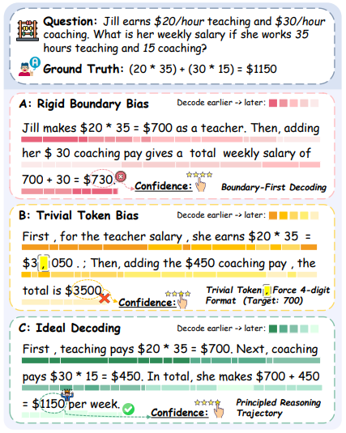



ACL 2026 Oral

## Empirical Analysis of Decoding Biases in Masked Diffusion Models


`Pengcheng Huang`, Tianming Liu, Zhenghao Liu†, Yukun Yan, Shuo Wang, Tong Xiao, Zulong Chen, Maosong Sun

`Pengcheng Huang`, Tianming Liu, Zhenghao Liu†, et&nbsp;al.


<a href="https://aclanthology.org/2026.acl-long.311/">ACL AnthologyPaper</a><a href="https://arxiv.org/abs/2508.13021">arXiv</a><a href="https://github.com/NEUIR/Uncode">Code</a><a href="https://passionate11.github.io/Uncode-project-page/">Project PageProject</a>



Training-free decoding calibration for masked diffusion language models.





Abstract

- This work reveals two systematic decoding biases in Masked Diffusion Models — rigid boundary bias and trivial token bias — and proposes Uncode (a.k.a. PC-Sampler, the name of its arXiv v1), a lightweight calibration framework that reshapes unmasking priorities via positional and semantic priors, outperforming existing decoding strategies by over 7% on average and achieving performance comparable to autoregressive models.



<!-- PamramMute_nips -->



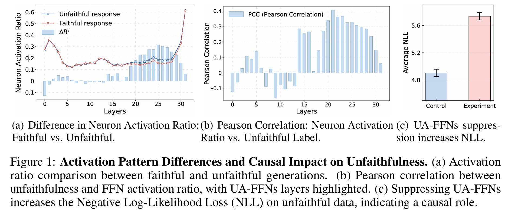



NeurIPS 2025

## ParamMute: Suppressing Knowledge-Critical FFNs for Faithful Retrieval-Augmented Generation


`Pengcheng Huang`, Zhenghao Liu†, Yukun Yan, Haiyan Zhao, Xiaoyuan Yi, Hao Chen, Zhiyuan Liu, Maosong Sun, Tong Xiao, Ge Yu, Chenyan Xiong

`Pengcheng Huang`, Zhenghao Liu†, Yukun Yan, et&nbsp;al.


<a href="https://openreview.net/forum?id=CyUq9D99vE">NeurIPSPaper</a><a href="https://arxiv.org/abs/2502.15543">arXiv</a><a href="https://github.com/OpenBMB/ParamMute">Code</a><a href="https://passionate11.github.io/ParamMute-project-page/">Project PageProject</a>



Suppressing knowledge-critical FFNs for more faithful retrieval-augmented generation.





Abstract

- This work presents ParamMute (a.k.a. PIP-KAG, the title of its early arXiv versions), a novel framework for enhancing the faithfulness of Retrieval-Augmented Generation. By identifying and suppressing unfaithfulness-associated feed-forward networks (FFNs), and incorporating a knowledge preference adaptation module, ParamMute effectively steers language models to better leverage retrieved evidence, paving the way for more reliable and trustworthy RAG systems.



<!-- ec2bench -->



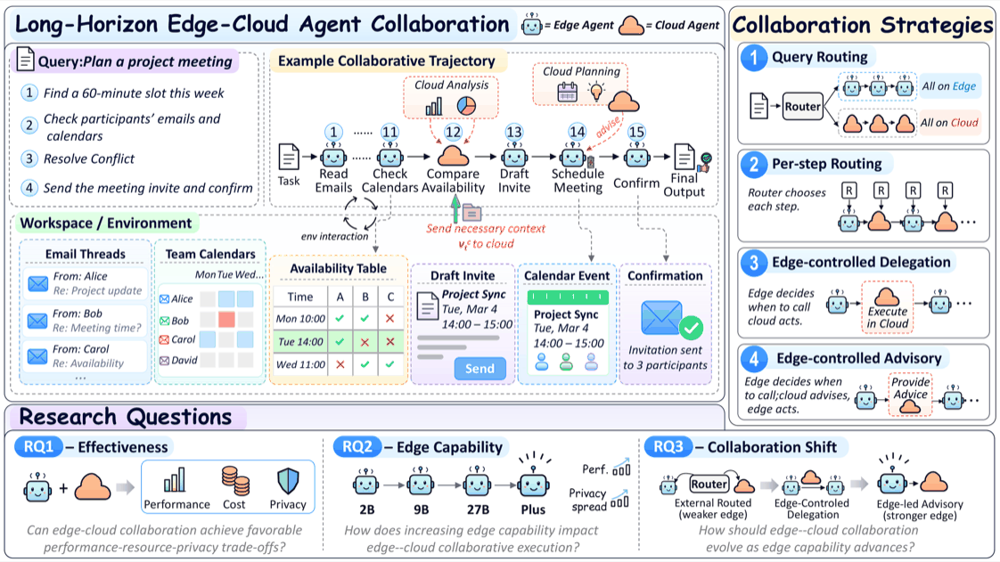



ArXiv

## Empowering Edge Agents: A Systematic Analysis of Edge-Cloud Collaboration in LLM Agent Execution


`Pengcheng Huang`, Zhenghao Liu†, Shixin Ren, Shi Yu, Sijia Yao, Yukun Yan†, Chaojun Xiao†, Maosong Sun

`Pengcheng Huang`, Zhenghao Liu†, Shixin Ren, et&nbsp;al.


<a href="https://arxiv.org/abs/2610.17816">arXiv</a><a href="https://github.com/OpenBMB/EC2-Bench">Code</a><a href="https://passionate11.github.io/ec2-bench-project-page/">Project PageProject</a><a href="https://huggingface.co/datasets/chengpingan/EC2-Bench">Dataset</a>



A systematic study of when and how edge agents should collaborate with the cloud.





Abstract

- This work introduces EC²-Bench (EC2-Bench), a benchmark for edge–cloud collaboration in long-horizon LLM agents with 128 executable digital-workspace tasks (100 privacy-annotated), jointly measuring task performance, resource usage and privacy exposure. It shows that collaboration balances the three, that stronger edge models close the performance gap but not the privacy gap, and that the preferred collaboration mode shifts from external routing toward edge-controlled cloud advisory as edge capability grows.



<!-- Expandr_EMNLP_oral -->



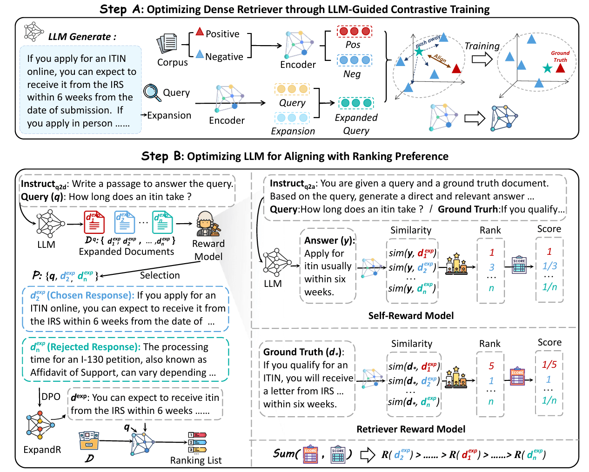



EMNLP 2025 Oral

## ExpandR: Teaching Dense Retrievers Beyond Queries with LLM Guidance


Sijia Yao*, `Pengcheng Huang*`, Zhenghao Liu†, Yu Gu, Yukun Yan, Shi Yu, Ge Yu

Sijia Yao*, `Pengcheng Huang*`, Zhenghao Liu†, et&nbsp;al.


<a href="https://arxiv.org/abs/2502.17057">arXiv</a><a href="https://github.com/NEUIR/ExpandR">Code</a>



Jointly learning query expansion and dense retrieval with LLM guidance.





Abstract

- This work introduces ExpandR, a unified framework that jointly trains a large language model (LLM) and a dense retriever by having the LLM generate rich query expansions and optimizing both expansion generation (via Direct Preference Optimization with combined rewards for retrieval utility and consistency) and retriever ranking performance at the same time, resulting in >5% boost over strong baselines on retrieval benchmarks.



<!-- longmab_acl26 -->



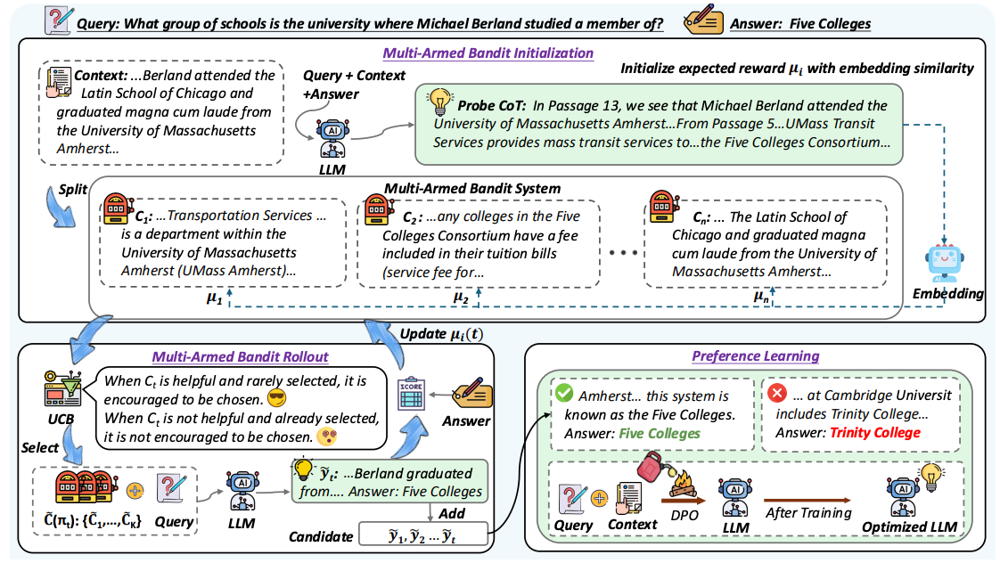



ACL 2026 Oral

## Chunks as Arms: Multi-Armed Bandit-Guided Sampling for Long-Context LLM Preference Optimization


Shaohua Duan\*, `Pengcheng Huang*`, Xinze Li\*, Zhenghao Liu†, Xiaoyuan Yi, Yukun Yan, Shuo Wang, Yu Gu, Ge Yu, Maosong Sun

Shaohua Duan\*, `Pengcheng Huang*`, Xinze Li\*, et&nbsp;al.


<a href="https://aclanthology.org/2026.acl-long.161/">ACL AnthologyPaper</a><a href="https://arxiv.org/abs/2508.13993">arXiv</a><a href="https://github.com/NEUIR/LongMab-PO">Code</a>



Bandit-guided preference data sampling for long-context language models.





Abstract

- This work proposes LongMab, a framework that treats divided context chunks as arms of a Multi‑Armed Bandit and leverages a UCB‑guided rollout strategy to progressively identify the most informative chunk combinations for sampling high‑quality, diverse responses, which are then used to construct effective preference pairs for DPO training, achieving over 4% average improvement on long‑context reasoning benchmarks across both Llama and Qwen.



<!-- sac iclr -->



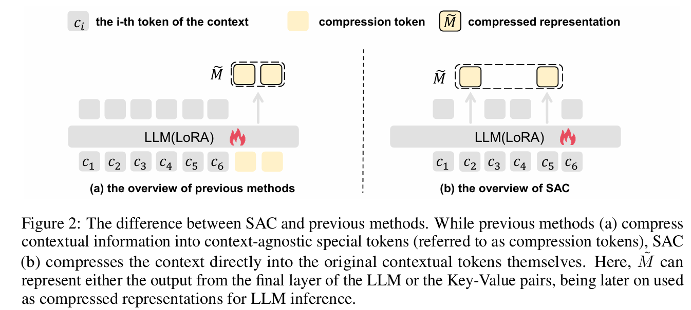



ICLR 2026

## Autoencoding-free context compression for llms via contextual semantic anchors


Xin Liu\*, Runsong Zhao\*, `Pengcheng Huang`, Xinyu Liu, Junyi Xiao, Chunyang Xiao, Tong Xiao†, Shengxiang Gao, Zhengtao Yu, Jingbo Zhu

Xin Liu\*, Runsong Zhao\*, `Pengcheng Huang`, et&nbsp;al.


<a href="https://arxiv.org/abs/2510.08907">arXiv</a>



Efficient context compression with contextual semantic anchors.





Abstract

- This paper introduces Semantic-Anchor Compression (SAC), a novel method that achieves efficient context compression for LLMs by directly selecting and aggregating information into contextual "anchor tokens," bypassing the limitations of traditional autoencoding-based training.





<!-- Tool master -->



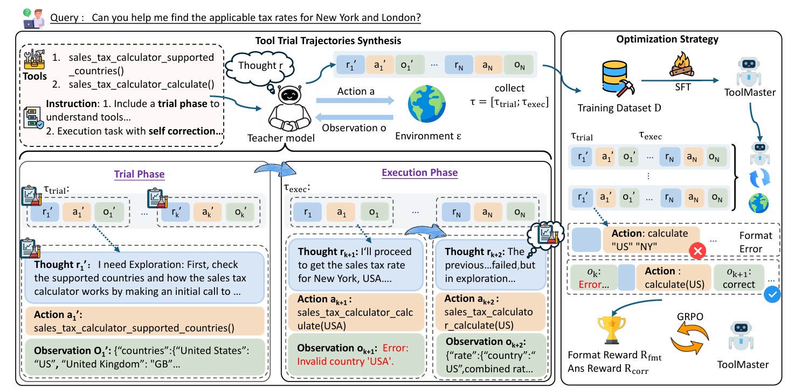



ArXiv

## Teaching LLMs to Learn Tool Trialing and Execution through Environment Interaction

Xingjie Gao*, `Pengcheng Huang*`, Zhenghao Liu†, Yukun Yan, Shuo Wang, Zulong Chen, Chen Qian, Ge Yu, Yu Gu

<a href="https://arxiv.org/abs/2601.12762">arXiv</a><a href="https://github.com/NEUIR/ToolMaster">Code</a>



Abstract

- This paper proposes ToolMaster, a framework that enables LLMs to master complex tool usage by shifting from passive imitation of expert trajectories to an active trial-and-execution paradigm, where models learn to explore and self-correct through direct environment interaction.



<!-- spark_arxiv26 -->



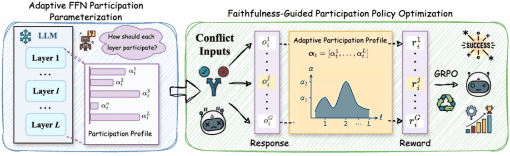



ArXiv

## SPARK: Adaptive Parametric Knowledge Participation for Faithful Retrieval-Augmented Generation

Ruochang Li\*, `Pengcheng Huang*`, Zhenghao Liu†, Yukun Yan, Huiyuan Xie, Yu Gu, Ge Yu, Maosong Sun

<a href="https://arxiv.org/abs/2606.27786">arXiv</a><a href="https://github.com/OpenBMB/SPARK">Code</a>



Abstract

- This work presents SPARK (a.k.a. SHIFT, the title of its arXiv v1), which treats control of parametric knowledge in RAG as learning a latent participation policy: a lightweight policy trained with a faithfulness-oriented reward modulates how much FFN-stored knowledge contributes during generation while the backbone LLM stays frozen, adding only 0.01% trainable parameters and giving more faithful answers on six datasets.



<!-- Forgetting_curve_EMNLP -->



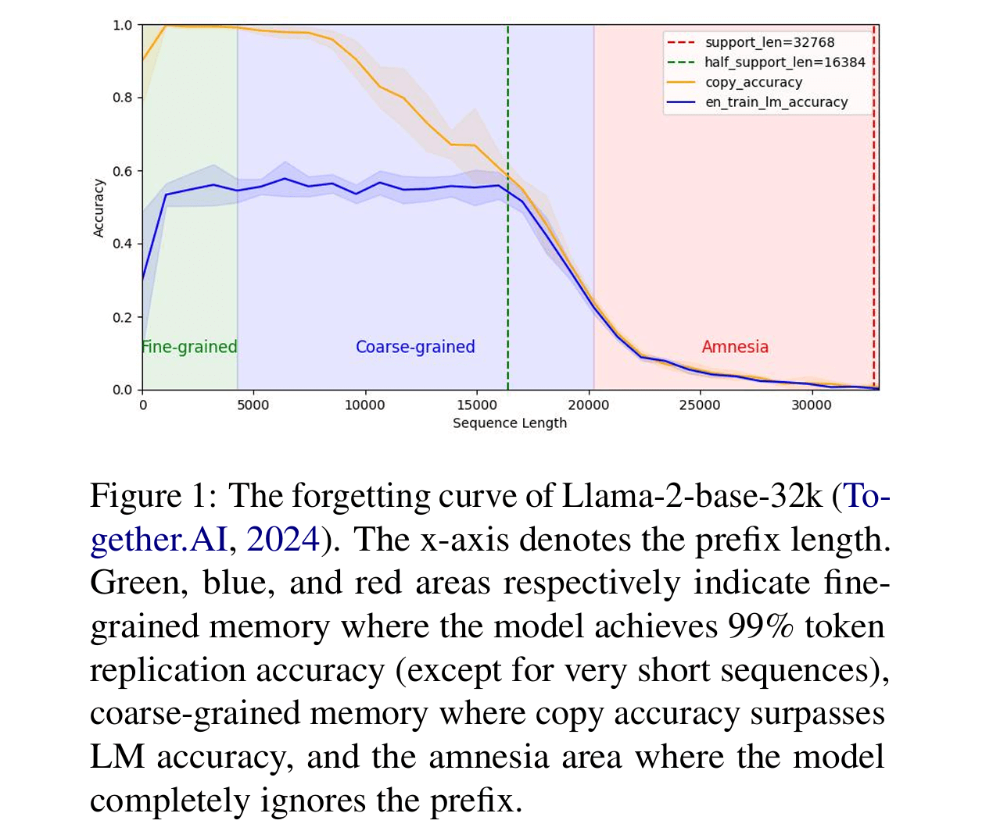



EMNLP 2024

## Forgetting curve: A reliable method for evaluating memorization capability for long-context models

Xinyu Liu, Runsong Zhao, `Pengcheng Huang`, Chunyang Xiao, Bei Li, Jingang Wang, Tong Xiao†, Jingbo Zhu

<a href="https://arxiv.org/abs/2410.04727">arXiv</a>



Abstract

- This work discovered that existing methods for measuring memorization in long‑context models (e.g. via perplexity or “needle in a haystack” tasks) are unreliable—being overly sensitive to prompts, corpora, or downstream tasks—and proposes the Forgetting Curve, a prompt‑free, robust metric based on comparing copy accuracy vs. LM accuracy over prefixes to more faithfully capture a model’s memory over long contexts, revealing that many claimed context extension techniques may not truly improve memorization for very long inputs.



<!-- positionid_EMNLP -->



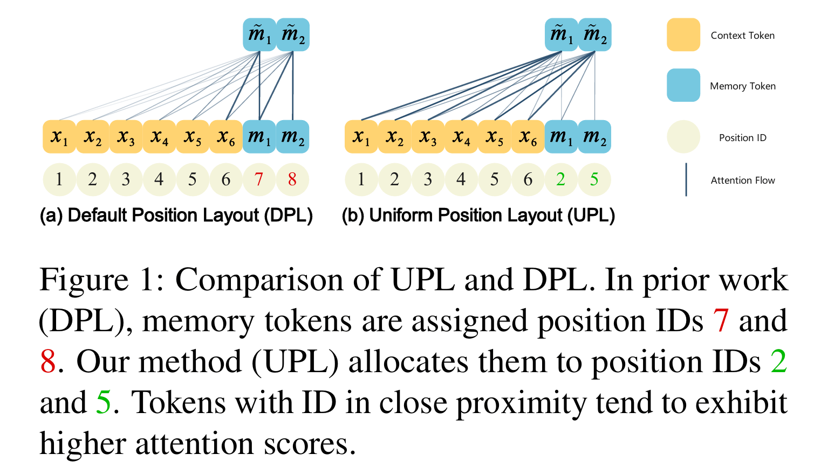



EMNLP 2025

## Position IDs Matter: An Enhanced Position Layout for Efficient Context Compression in Large Language Models

Runsong Zhao, Xin Liu, Xinyu Liu, `Pengcheng Huang`, Chunyang Xiao, Tong Xiao†, Jingbo Zhu

<a href="https://arxiv.org/abs/2409.14364">arXiv</a>



Abstract

- This work identifies that existing LLM context‑compression methods like ICAE suffer from suboptimal position identifier layouts for compressed tokens and that the auto‑encoding loss alone insufficiently promotes memorization; it then proposes spreading position identifiers uniformly across input and introducing a “compression loss” focused purely on memorization, enabling much higher compression ratios (up to ~15× vs 4×) while retaining reconstruction and downstream performance.



<!-- rag_survey -->



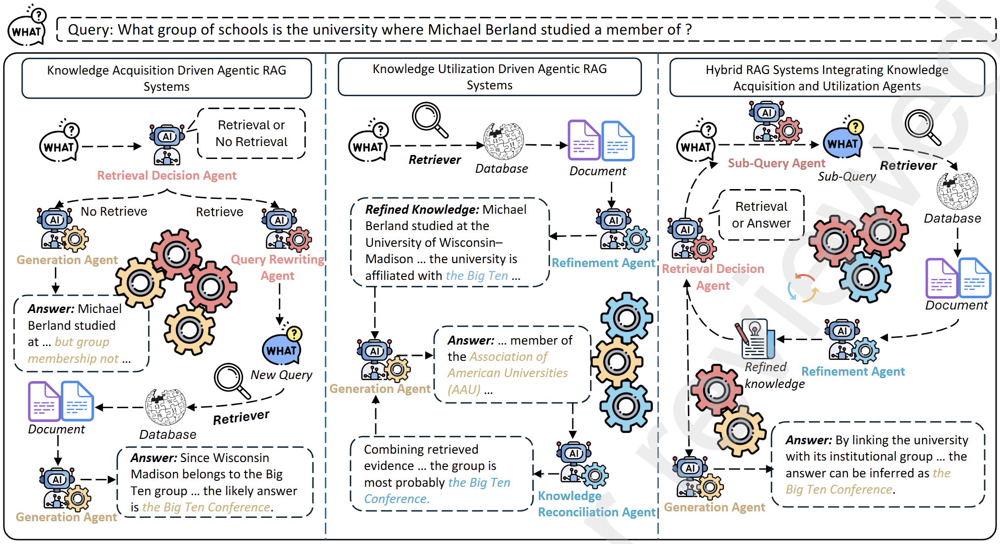



AI Open 2025

## Knowledge Intensive Agents

Zhenghao Liu†, `Pengcheng Huang`, Zhipeng Xu, Xinze Li, Shuliang Liu, Chunyi Peng, Haidong Xin, Yukun Yan, Shuo Wang, Xu Han, Zhiyuan Liu, Maosong Sun, Yu Gu, Ge Yu

<a href="https://papers.ssrn.com/sol3/Delivery.cfm/81afde5f-fbd1-4635-b582-7ac104b3322a-MECA.pdf?abstractid=5459034&amp;mirid=1">**📄PDF**</a>



Abstract

- This work provides a comprehensive overview of Retrieval-Augmented Generation from an agentic perspective, categorizing knowledge-intensive agents into acquisition and utilization roles, and highlighting future directions for joint optimization in multi-agent RAG systems.



<!-- ClueAnchor_EMNLP -->



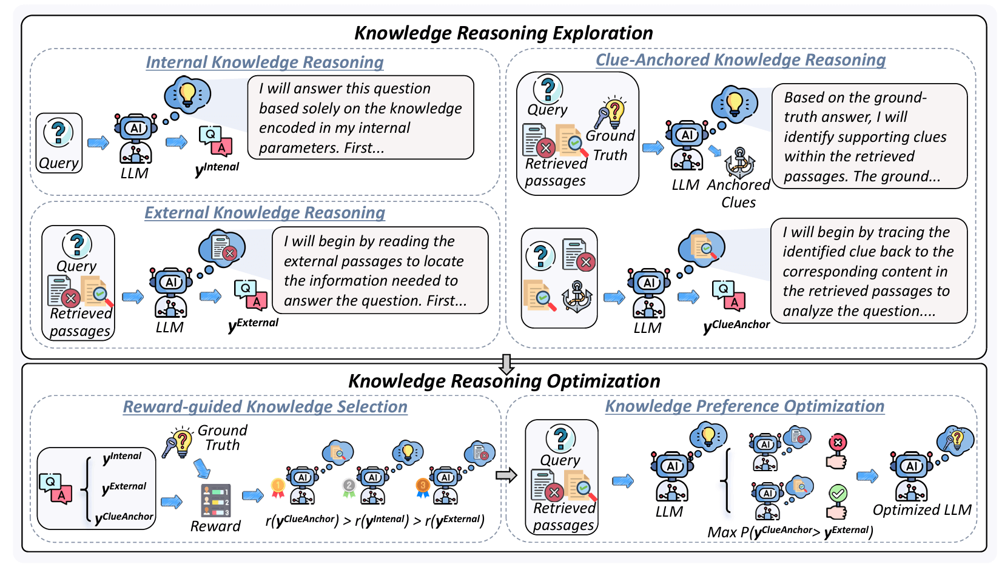



EMNLP 2025

## ClueAnchor: Clue-Anchored Knowledge Reasoning Exploration and Optimization for Retrieval-Augmented Generation

Hao Chen, Yukun Yan, Sen Mei, Wanxiang Che, Zhenghao Liu, Qi Shi, Xinze Li, Yuchun Fan, `Pengcheng Huang`, Qiushi Xiong, Zhiyuan Liu, Maosong Sun

<a href="https://arxiv.org/abs/2505.24388">arXiv</a>



Abstract

- This work discovered that RAG systems often under‐utilize retrieved documents because critical evidence (“clues”) is implicit, dispersed, or obscured by noise, and ClueAnchor addresses this by first extracting key clues from the retrieved content, generating multiple reasoning paths under different knowledge configurations (internal, external, and clue‑anchored), and then using reward‑based preference optimization to select the most effective path — yielding much better reasoning completeness and robustness.



<!-- attn floating mdm -->



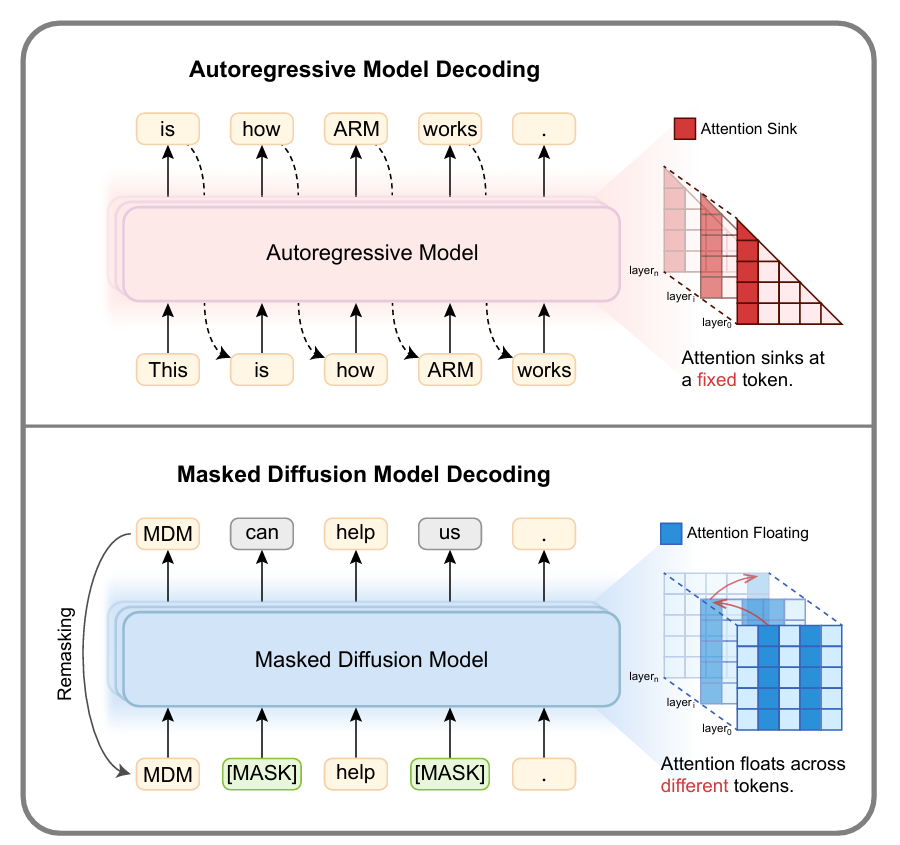



ACL 2026 Findings

## Revealing the Attention Floating Mechanism in Masked Diffusion Models

Xin Dai, `Pengcheng Huang`, Zhenghao Liu†, Shuo Wang, Yukun Yan, Chaojun Xiao, Yu Gu, Ge Yu, Maosong Sun

<a href="https://aclanthology.org/2026.findings-acl.404/">ACL Anthology</a><a href="https://arxiv.org/abs/2601.07894">arXiv</a><a href="https://github.com/NEUIR/Attention-Floating">Code</a>



Abstract

- This paper investigates the internal attention behaviors of Masked Diffusion Models (MDMs), identifying a unique "Attention Floating" mechanism where attention anchors dynamically shift across layers and denoising steps, which provides a mechanistic explanation for their superior in-context learning performance compared to autoregressive models.



<!-- CARD -->



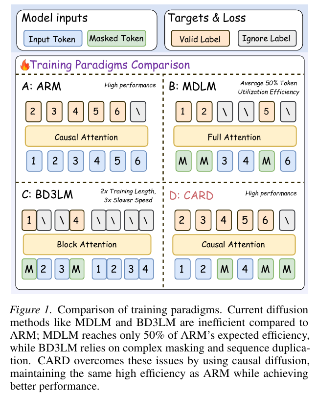



ArXiv

## Causal Autoregressive Diffusion Language Model

Junhao Ruan, Bei Li, Yongjing Yin, `Pengcheng Huang`, Xin Chen, Jingang Wang, Xunliang Cai, Tong Xiao†, JingBo Zhu

<a href="https://arxiv.org/abs/2601.22031">arXiv</a>



Abstract

- This paper introduces Causal Autoregressive Diffusion (CARD), a framework that unifies the training efficiency of autoregressive models with the high-throughput parallel inference of diffusion models by using a strictly causal attention mask and a dynamic decoding mechanism.



<!-- TAR_CCL -->



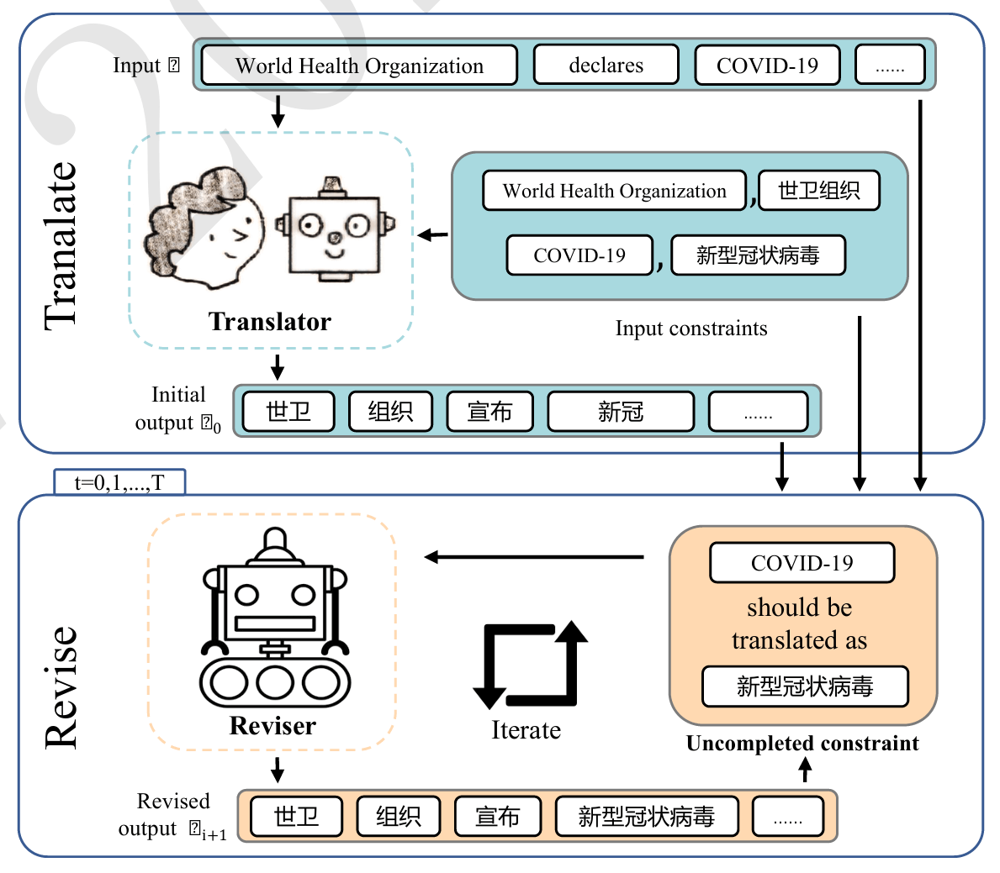



CCL 2024

## Translate-and-Revise: Boosting Large Language Models for Constrained Translation

`Pengcheng Huang`, Yongyu Mu, Yuzhang Wu, Bei Li, Chunyang Xiao, Tong Xiao†, Jingbo Zhu

<a href="https://arxiv.org/abs/2407.13164">arXiv</a><a href="https://aclanthology.org/2024.ccl-1.82/">PDF</a><a href="https://passionate11.github.io/Translate-and-Revise-project-page/">Project Page</a>



Abstract

- This work discovers that large language models (LLMs) prompted for constrained translation often ignore or violate specified lexical or structural constraints—partly because they’re overly confident and let their own fluency priorities override constraint satisfaction—and Translate‑and‑Revise remedies this by adding a revision process that prompts the model to identify unmet constraints and correct its output, yielding ~15% improvement in constraint translation accuracy and surpassing NMT baselines.



<!-- speech grpo -->



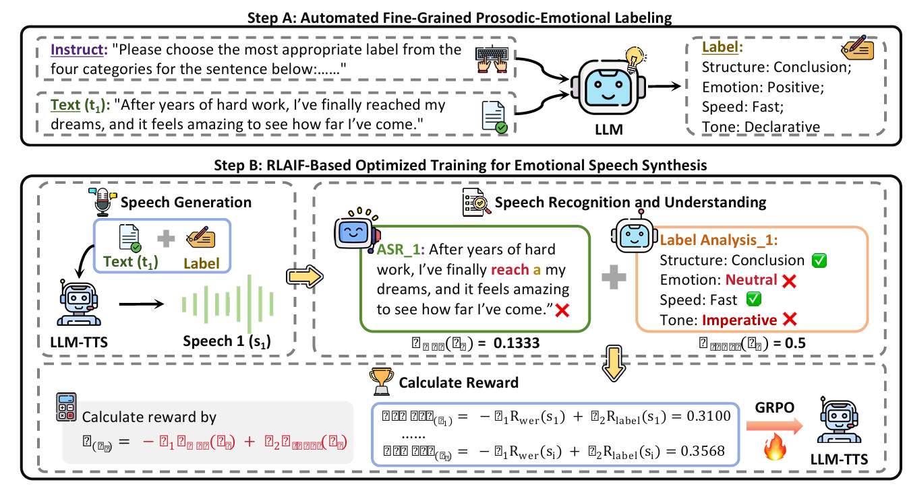



IJCNN 2026

## RLAIF-SPA: Optimizing LLM-based Emotional Speech Synthesis via RLAIF

Qing Yang, Zhenghao Liu†, Junxin Wang, Yangfan Du, `Pengcheng Huang`, Tong Xiao

<a href="https://arxiv.org/abs/2510.14628">arXiv</a>



Abstract

- This paper proposes RLAIF-SPA, a framework that enhances the emotional expressiveness and prosodic naturalness of LLM-based speech synthesis by using Reinforcement Learning from AI Feedback to optimize semantic accuracy and fine-grained prosodic alignment.



<!-- memorycard_arxiv26 -->



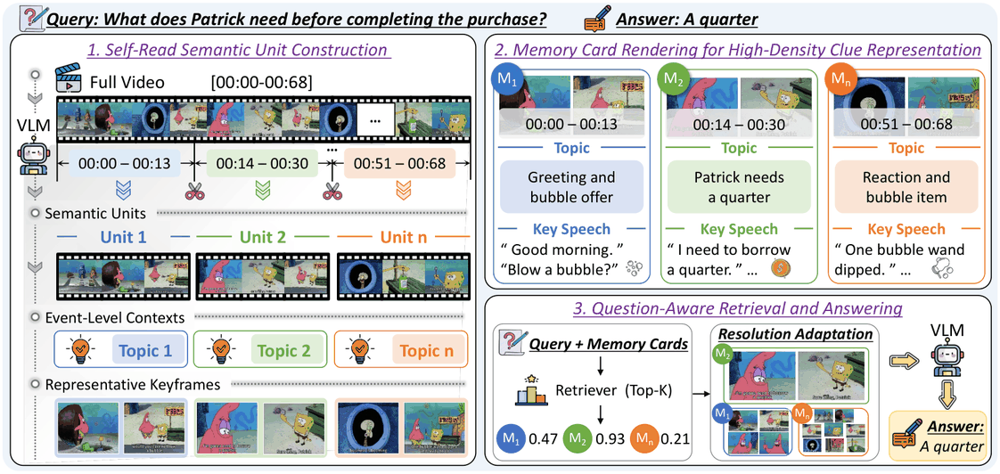



EMNLP 2026

## MemoryCard: Topic-Aware Multi-Modal Clue Compression for Long-Video Question Answering

Qing Yang, `Pengcheng Huang`, Xinze Li, Zhenghao Liu†, Yukun Yan, Yu Gu, Ge Yu, Gang Li, Maosong Sun

<a href="https://arxiv.org/abs/2606.05917">arXiv</a><a href="https://github.com/NEUIR/MemoryCard">Code</a>



Abstract

- This work proposes MemoryCard, which self-reads a long video and its aligned utterances to split it into topic- or event-level units and renders each unit into a Memory Card (an event-level gist plus representative frames) for retrieval and answering, improving long-video QA accuracy by up to 21.8% (relative) under comparable visual-token budgets.



<!-- memosight_arxiv26 -->



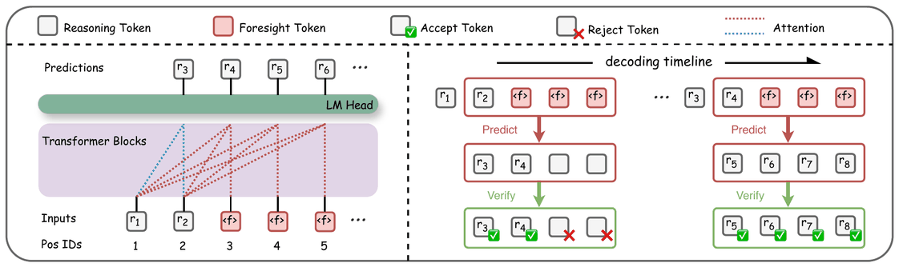



ArXiv

## MemoSight: Unifying Context Compression and Multi Token Prediction for Reasoning Acceleration

Xinyu Liu, Xin Liu, Bo Jin, Runsong Zhao, `Pengcheng Huang`, Junhao Ruan, Bei Li, Chunyang Xiao, Chenglong Wang, Tong Xiao, Jingbo Zhu

<a href="https://arxiv.org/abs/2604.14889">arXiv</a>



Abstract

- This work proposes MemoSight, which unifies context compression (memory tokens) and multi-token prediction (foresight tokens) in one minimalist special-token design with token-specific positional layouts; on four reasoning benchmarks it cuts the KV cache by up to 66% and speeds up inference by 56% with under a 3% drop in average accuracy.



<!-- hybridthinker_arxiv26 -->



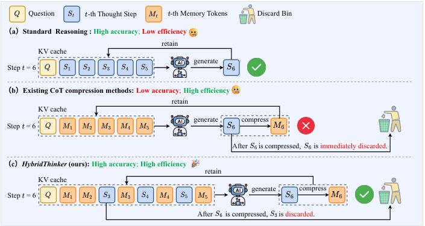



EMNLP 2026

## HybridThinker: Efficient Chain-of-Thought Reasoning via Compressed Memory and Transient Thought Steps

Xin Liu\*, Runsong Zhao\*, Xinyu Liu, Junhao Ruan, `Pengcheng Huang`, Shichao Dong, Chunyang Xiao, Chenglong Wang, Changliang Li, Jingbo Zhu, Tong Xiao†

<a href="https://arxiv.org/abs/2606.03768">arXiv</a>



Abstract

- This work proposes HybridThinker, which compresses chain-of-thought steps into memory tokens while temporarily keeping the raw steps for fine-grained detail, and trains with a hybrid attention scheme that masks some steps so the model must compress and retrieve through memory tokens; it matches the uncompressed baseline on 4 reasoning benchmarks and beats prior CoT compression by 5.8 points on average.







<a href="/publications/" target="_self">View all 19 publications →</a>


